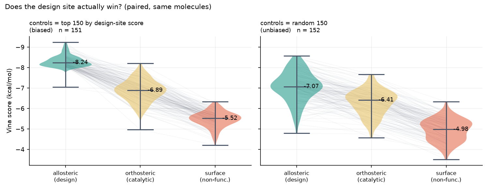

# tem1-allosteric-design — de novo design against the TEM-1 allosteric pocket

Three different generative paradigms, one experimentally validated allosteric
site, and a docking protocol that has to **earn the right to be used** before
any molecule is designed.

> **Attribution.** The scientific design of this project is my own. I used
> Claude Code (Anthropic) as a coding and documentation assistant. Every
> number below was produced by the code in this repository and can be
> reproduced with the commands given.

---

## The target

TEM-1 β-lactamase — the archetypal antibiotic-resistance enzyme — has an
allosteric pocket about 19 Å from the catalytic Ser70, between helix H11 and
the Ω-loop. Horn & Shoichet
([*J. Mol. Biol.* **336**:1283, 2004](https://doi.org/10.1016/j.jmb.2003.12.068))
showed that non-β-lactam ligands binding there inhibit by **core disruption**:
they block the conformational change catalysis requires, rather than competing
with substrate.

| PDB | Ligand | Chemistry |
|---|---|---|
| [1PZO](https://www.rcsb.org/structure/1PZO) | **CBT** | N,N-bis(4-chlorobenzyl)-1H-tetrazol-5-amine |
| [1PZP](https://www.rcsb.org/structure/1PZP) | **FTA** | 3-(4-phenylamino-phenylamino)-2-(1H-tetrazol-5-yl)acrylonitrile |

Both crystals contain **two copies** of their ligand, and only one per
structure is the allosteric site. `scripts/identify_pocket.py` makes that call
from the structures themselves — contact count, hydrophobicity of the lining
and distance from Ser70 — rather than by assertion:

```
1PZO CBT  copy 300: 12 contacts, 58% hydrophobic, 10.2 Å from Ser70-OG
         copy 301: 12 contacts, 75% hydrophobic, 17.6 Å from Ser70-OG   <- allosteric
1PZP FTA  copy 300: 16 contacts, 88% hydrophobic, 21.6 Å from Ser70-OG  <- allosteric
         copy 301:  6 contacts, 50% hydrophobic, 29.3 Å from Ser70-OG   (lattice site)
```

The shared lining is strikingly greasy — Leu221, Ala224, Leu225, Val261,
Ile263, Ile279, Ala280, Gly283, Leu286 — which is why the site tolerates the
bis-chlorobenzyl chemotype.

---

## The part most pipelines skip: validating the docking

Before designing anything, the protocol was tested by redocking the
crystallographic ligands. It **failed** in the obvious setup, and the failure
mode is instructive ([full matrix](outputs/VALIDATION.md)):

| Ligand | Receptor | Waters | Co-ligand | Vina score | Crystal-pose score | RMSD | Success |
|---|---|---|---|---|---|---|---|
| FTA300 | 1PZP | ✗ | – | −8.08 | −5.71 | 3.52 Å | no |
| **FTA300** | **1PZP** | **✓** | – | **−8.44** | −6.52 | **0.98 Å** | **yes** |
| CBT301 | 1PZO | ✓ | – | −8.04 | −6.66 | 7.80 Å | no |
| CBT301 | 1PZO | ✓ | CBT300 | −8.42 | −7.60 | 3.11 Å | no |
| **CBT300** | **1PZO** | **✓** | **CBT301** | **−7.80** | −7.25 | **1.73 Å** | **yes** |

Three things worth stating plainly:

1. **Ordered waters are not optional here.** Stripping them moves FTA from
   0.98 Å (a textbook redocking success) to 3.52 Å.
2. **The two CBT copies build each other's site.** CBT300 only redocks
   correctly when copy 301 is left in the receptor — the cleft is one extended
   groove occupied by two ligands.
3. **Where redocking fails, the crystal pose also *scores worse* than the pose
   Vina prefers.** That is a scoring-function failure, not just a sampling
   failure, and no amount of extra exhaustiveness fixes it.

Design therefore runs **only** on the validated setup: 1PZP with
crystallographic waters, Vina, box around the FTA site. Vinardo was tested and
was worse everywhere.

---

## Three generators, deliberately different

| | Paradigm | What it can and cannot invent |
|---|---|---|
| **CReM** | knowledge-based fragment replacement | every fragment comes from a ChEMBL-derived database, matched on chemical context — synthetically plausible by construction, but cannot leave known fragment space |
| **SELFIES GA** | evolutionary search in a robust string space | mutation/crossover on a representation where almost any token string decodes to a valid molecule — maximal freedom, minimal chemical taste |
| **SAFE-GPT** | pretrained autoregressive sequence model | a learned prior over drug-like chemistry; used in scaffold-decoration mode from the shared tetrazole anchor |

All three are seeded from, or anchored on, the crystallographic ligands, then
put through the identical filter cascade.

### Result: the paradigms differ enormously in usable yield

| Generator | Raw | Unique valid | Passed filters | **Pass rate** | Median QED | Median SA | Median MW |
|---|---|---|---|---|---|---|---|
| CReM | 3000 | 3000 | 1826 | **60.9%** | 0.71 | 2.09 | 341 |
| SAFE-GPT | 2206 | 2147 | 500 | **23.3%** | 0.61 | 3.51 | 247 |
| SELFIES GA | 1206 | 1206 | 93 | **7.7%** | 0.50 | 4.20 | 319 |

**6,352 unique molecules, 2,419 pass every filter.** The ordering —
knowledge-based ≫ learned prior ≫ naive evolutionary — is the clearest result
in the project, and it is a yield statement, not a quality-of-best-hit
statement.

A sanity check on the filters themselves: they flag **FTA**, one of the two
literature ligands, for its acrylonitrile Michael acceptor. That is chemically
correct, and a useful reminder that "passes the filters" and "is a good
molecule" are different claims.

---

## Triage: four independent hurdles

Because the validation showed the Vina score alone cannot be trusted in this
pocket, no candidate is selected on score:

1. **Affinity** — Vina score and ligand efficiency at the allosteric site
2. **Selectivity** — better there than at the catalytic (orthosteric) site
3. **Site specificity** — better there than at the second crystallographic FTA
   site, a surface position 29 Å from Ser70. This is a deliberately hard
   control: it is a *real* ligand-binding depression (FTA occupies it in the
   1PZP lattice), just one with no catalytic or allosteric role — so beating it
   means more than beating a random patch of surface.
4. **Binding-mode fidelity** — its ProLIF interaction fingerprint reproduces
   the reference ligand's contact pattern

Hurdles 2–4 are what separate a designed binder from a greasy molecule that
docks well everywhere.

### Does the design site actually win?

This is the claim the whole project rests on, so it is tested **paired** — the
same molecule docked at all three sites — and with two different control sets,
because the choice of control molecules can manufacture the answer.



| control set | vs orthosteric | vs surface |
|---|---|---|
| top 150 by design-site score (**biased**) | +1.42 kcal/mol, 99.3% favour | +2.82, 100% |
| random 150 (**unbiased**) | **+0.84 kcal/mol, 86.8% favour** | **+2.17, 100%** |

Selecting the control molecules on their design-site score — the obvious thing
to do, since those are the molecules you care about — **overstates the
orthosteric advantage by 68%**, because it selects on the very quantity under
test. The preference survives the unbiased control (p = 1×10⁻²⁰), so it is
real; but +0.84 kcal/mol is the number to quote, not +1.42.

### Outcome

| | |
|---|---|
| Docked at the allosteric site | 1,222 |
| Clear the affinity hurdle (≥ FTA, −8.42) | 46 |
| Clear all four hurdles | 44 |
| — of which a **known ligand recovered** (FTA) | 1 |
| — **designed** candidates | **43**, all from CReM |

FTA, a crystallographic ligand of this pocket, clears every hurdle unchanged.
That is a positive control, not a result, and it is excluded from the candidate
count. Neither the SELFIES-GA nor the SAFE-GPT molecules produced a single
candidate — the yield ordering from the filter stage persists all the way
through docking.

The 43 designed candidates score −9.24 to −8.42 kcal/mol (43 of 43 better than
the best reference), with median QED 0.67, median SA 1.91, and median Tanimoto
to the references of 0.20 — chemically distinct from the literature ligands.

Full funnel, per-generator breakdown and the ranked table are in
[outputs/RESULTS.md](outputs/RESULTS.md).

---

## Reproducing

```bash
conda create -n tem1 -c conda-forge python=3.11 rdkit numpy scipy pandas \
    matplotlib openbabel -y
conda activate tem1
pip install -r requirements.txt

bash scripts/fetch_structures.sh      # 1PZO, 1PZP, 1BTL from RCSB
bash scripts/download_crem_db.sh      # CReM fragment DB (~846 MB -> 5.8 GB)

python scripts/identify_pocket.py     # which ligand copy is the real site
python run_validate.py                # docking protocol validation  -> VALIDATION.md
python run_generate.py --n 3000       # three generators + filters
python run_screen.py  --workers 22 --subset 1100 --sites allosteric
python run_screen.py  --workers 22 --sites orthosteric,surface --top-from-allosteric 150
# unbiased control: same two sites on a RANDOM sample, independent of score
python run_screen.py  --workers 22 --sites orthosteric,surface \
                      --random-from-allosteric 150 --seed 0 --tag _random
python run_analyze.py                 # ranking, figures -> RESULTS.md
pytest -q
```

Receptor preparation is the only step needing the Open Babel CLI, and its
output is cached, so a compute node without Open Babel can run everything else.

### Layout

```
tem1_design/
  config.py      pocket definition, validated protocol, filter thresholds
  structure.py   PDB parsing, pocket identification, receptor prep
  validate.py    redocking / cross-docking benchmark
  filters.py     properties, PAINS+Brenk alerts, novelty
  generate/      crem_gen.py · selfies_ga.py · safe_gen.py
  dock.py        Vina wrapper, 3D embedding, pose RMSD
  screen.py      resumable parallel screening
  plif.py        ProLIF fingerprints, binding-mode fidelity
  score.py       four-hurdle triage and consensus ranking
  plots.py       figures
```

Docking was run on a 24-core node (`solaris/node5`); everything else runs on a
laptop.

---

## What this is not

- **No compound here is experimentally validated.** These are docking-ranked
  proposals. β-lactamase inhibition is straightforward to assay, and until
  someone does, "hit" is the wrong word.
- The receptor is **rigid**, while the whole point of this site is that it is
  conformationally responsive. Rigid docking cannot model the induced fit that
  makes core disruption work.
- Selectivity and site specificity are **differences between docking scores**,
  not measured selectivity. They are reported paired and against an unbiased
  random control, but a Vina score difference is still not an affinity.
- **The three docking boxes are not identical volumes.** A more enclosed box
  tends to score better for purely geometric reasons, so part of the
  site preference may be box geometry rather than biology.
- Novelty is measured against the two reference ligands only — no patent or
  full-ChEMBL search was run.
- The screen docks a MaxMin diversity-selected subset of the filtered library,
  not all of it; docking is the bottleneck.

## License

MIT — see [LICENSE](LICENSE). Cite via [CITATION.cff](CITATION.cff).
