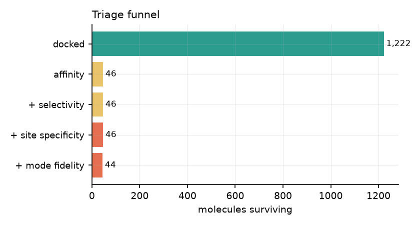
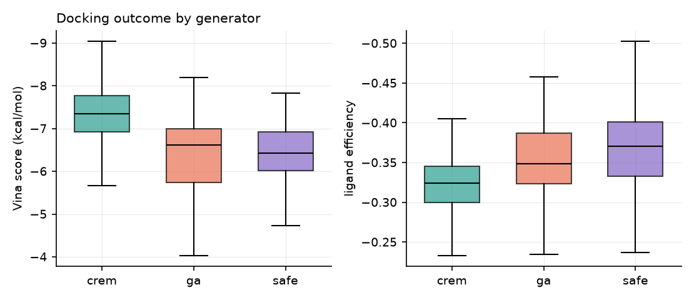
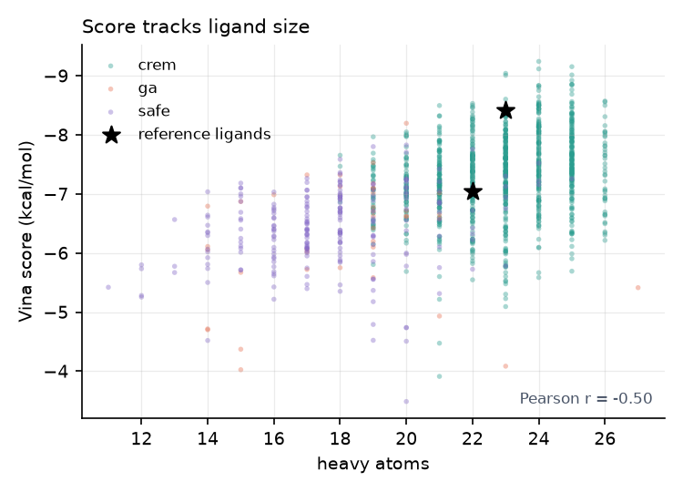
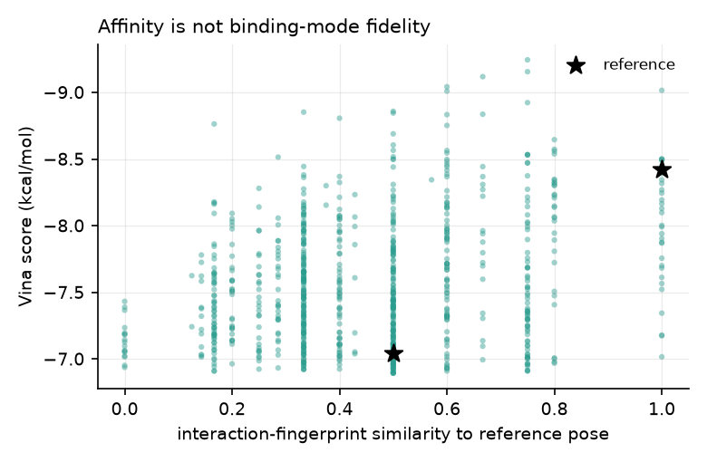

# Results — de novo design against the TEM-1 allosteric pocket

*Generated in 6s on sutanu-ThinkCentre-M80t. Docking protocol validated in [VALIDATION.md](VALIDATION.md).*

## What was screened

- **1,222 molecules** docked at the allosteric site
- **267** also docked at the orthosteric (catalytic) site
- **151** also docked at the non-functional surface site

### Reference ligands under the same protocol

| smiles                                   |   score_allosteric |   le_allosteric |   score_orthosteric |   score_surface |   plif_similarity |
|:-----------------------------------------|-------------------:|----------------:|--------------------:|----------------:|------------------:|
| Clc1ccc(CN(Cc2ccc(Cl)cc2)c2nnn[nH]2)cc1  |             -7.045 |       -0.320227 |              -6.511 |          -5.4   |               0.5 |
| N#C/C(=C\Nc1ccc(Nc2ccccc2)cc1)c1nnn[nH]1 |             -8.42  |       -0.366087 |              -7.55  |          -6.329 |               1   |

## Does the design site actually win? (paired control)

Wilcoxon signed-rank on molecules docked at **all three** sites. Positive `median_delta_kcal` means the allosteric site scored better for the *same* molecule. Comparing whole distributions instead would contrast different molecule sets and prove nothing.

Two control sets are reported because the choice of control molecules can manufacture the result. The **biased** set is the top scorers at the design site — selected on the very quantity under test, so part of its advantage is regression to the mean. The **unbiased** set is a random sample docked at all three sites.

| control_set                            | control_site   |   n_paired |   median_delta_kcal |   frac_favouring_allosteric |   wilcoxon_p |
|:---------------------------------------|:---------------|-----------:|--------------------:|----------------------------:|-------------:|
| top-150 by allosteric score (biased)   | orthosteric    |        151 |              1.42   |                    0.993377 |  1.60705e-26 |
| top-150 by allosteric score (biased)   | surface        |        151 |              2.819  |                    1        |  1.57512e-26 |
| random 150 (unbiased)                  | orthosteric    |        152 |              0.8435 |                    0.868421 |  1.31856e-20 |
| random 150 (unbiased)                  | surface        |        152 |              2.173  |                    1        |  1.07914e-26 |
| random 150, volume-matched cubic boxes | orthosteric    |        152 |              1.3155 |                    0.894737 |  7.28474e-24 |
| random 150, volume-matched cubic boxes | surface        |        152 |              2.191  |                    1        |  1.07906e-26 |

Selecting controls on the design-site score inflates the orthosteric advantage from **+0.84** to **+1.42** kcal/mol (68% overstatement) and the fraction favouring the design site from 86.8% to 99.3%. **The effect survives the unbiased control**, so the site preference is real — but the unbiased number is the one to quote.

The production boxes are **not equal in volume** (allosteric 5 953 A^3, orthosteric 10 560 A^3), and Vina scores depend on search volume, so the comparison was repeated with identical 18.12 A cubes at all three centres. The preference does not shrink — it **grows**, to **+1.32** kcal/mol (89.5% of molecules). The oversized orthosteric box was scoring that site *better* and therefore understating selectivity, so the geometry confound ran in the conservative direction. The allosteric score itself barely moves (−7.07 production vs −7.10 cube), so the cube is not distorting the design site.

## Per-generator outcome

| source    |   n |   median_score |   best_score |   median_le |
|:----------|----:|---------------:|-------------:|------------:|
| crem      | 954 |        -7.3435 |       -9.244 |   -0.32433  |
| ga        |  39 |        -6.615  |       -8.197 |   -0.348632 |
| reference |   2 |        -7.7325 |       -8.42  |   -0.343157 |
| safe      | 227 |        -6.424  |       -7.829 |   -0.37075  |

## Triage funnel

Each hurdle is independent; a molecule that docks well everywhere is a sticky compound, not a designed binder. The control sites were docked only for the top slice of the library, so `n_not_tested_at_this_stage` counts molecules that cleared affinity but never had that comparison run.

Across all stages that is **0** molecule(s), so no hurdle is being decided by absent data.

| stage              |    n |   n_not_tested_at_this_stage |
|:-------------------|-----:|-----------------------------:|
| docked             | 1222 |                            0 |
| affinity           |   46 |                            0 |
| + selectivity      |   46 |                            0 |
| + site specificity |   46 |                            0 |
| + mode fidelity    |   44 |                            0 |

### How much does each hurdle actually filter?

| hurdle           |   n_before |   n_after |   removed |   n_tested | unconditional_pass_rate   | spearman_vs_dock_score   |
|:-----------------|-----------:|----------:|----------:|-----------:|:--------------------------|:-------------------------|
| affinity         |       1222 |        46 |      1176 |       1222 | 3.8%                      | —                        |
| selectivity      |         46 |        46 |         0 |        267 | 98.5%                     | -0.28                    |
| site specificity |         46 |        46 |         0 |        151 | 100.0%                    | -0.43                    |
| mode fidelity    |         46 |        44 |         2 |        800 | 77.9%                     | -0.22                    |

*Mode fidelity is weaker than its name suggests: the PLIF receptor excludes the crystallographic waters and has no hydrogens, so the FTA reference row carries only 4 hydrophobic bits. See the `tem1_design/plif.py` docstring.*

**selectivity and site specificity removed nothing.** Calling these independent hurdles overstates the triage: the candidate set is set almost entirely by the affinity cut, and every criterion correlates with the docking score it is meant to be independent of. They are sanity checks that nothing failed, not filters.

## The two known ligands, and why this is not a positive control

- **CBT** — docks at -7.04 kcal/mol and does **not** clear the triage.
- **FTA** — docks at -8.42 kcal/mol and clears all four hurdles.

The affinity hurdle is *defined* as "at least as good as the best reference", and the best reference is FTA, so **FTA passes by construction**. Recovering it is arithmetic, not validation, and it is excluded from the candidate count below.

CBT — the other crystallographic ligand of this same pocket — is the informative case: it docks 1.4 kcal/mol worse and **fails**. A threshold that rejects a known binder of the target site is a threshold tuned for docking score, not for binding. Read the candidate list as "molecules the scoring function likes at least as much as the better reference", nothing stronger.

## Top designed candidates

**43 designed molecules of 1,222 docked clear all four hurdles** (by generator: {'crem': 43}). Only these are listed: ranking the whole library together would mix molecules that passed the control comparisons with molecules that never had them run.

| smiles                                       | source   |   score_allosteric |   le_allosteric |   selectivity |   site_specificity |   plif_similarity |      qed |   sa_score |   max_sim_reference |   consensus_z |
|:---------------------------------------------|:---------|-------------------:|----------------:|--------------:|-------------------:|------------------:|---------:|-----------:|--------------------:|--------------:|
| Nc1cc(-c2ccc(Cl)cc2)nc2cc(-c3ccc(Cl)cc3)nn12 | crem     |             -9.244 |       -0.385167 |         2.851 |              3.443 |          0.75     | 0.553371 |    2.13217 |           0.204082  |      2.2237   |
| O=C(Nc1ccc(Oc2cccnc2)cc1)c1c(F)cccc1Cl       | crem     |             -9.118 |       -0.379917 |         2.175 |              3.766 |          0.666667 | 0.731867 |    1.8677  |           0.138889  |      1.79062  |
| O=C(Nc1cccc(F)c1)c1ccc(Oc2cccnc2)cc1         | crem     |             -9.042 |       -0.39313  |         2.148 |              3.546 |          0.6      | 0.782982 |    1.69681 |           0.126761  |      1.71319  |
| Cc1cccn2cc(-c3ccc(Nc4ccccc4)cc3)nc12         | crem     |             -9.009 |       -0.391696 |         2.083 |              3.528 |          0.6      | 0.573115 |    1.93046 |           0.233333  |      1.63095  |
| Cc1cc(C#N)cc2nc(-c3ccc(Nc4ccccc4)cc3)oc12    | crem     |             -9.155 |       -0.3662   |         2.01  |              3.004 |          0.75     | 0.546197 |    2.1597  |           0.269841  |      1.51991  |
| CC(O)c1ccc(-c2ccc(C(=O)Nc3ccc(Cl)cc3)cc2)cc1 | crem     |             -8.923 |       -0.35692  |         2.944 |              2.862 |          0.75     | 0.66856  |    2.07452 |           0.145455  |      1.46467  |
| CC1CCN(C(=O)c2ccc(Oc3cccnc3)cc2)CC1          | crem     |             -8.532 |       -0.387818 |         2.453 |              3.684 |          0.75     | 0.866069 |    1.84434 |           0.0821918 |      1.28647  |
| O=C(Nc1ccc(Nc2ccccc2)cc1)c1cc2ccccc2o1       | crem     |             -9.015 |       -0.3606   |         1.382 |              2.925 |          1        | 0.525098 |    1.7435  |           0.263158  |      1.20928  |
| NC(C(=O)O)c1ccc(C(=O)Nc2ccccc2Cl)cc1         | crem     |             -8.497 |       -0.404619 |         2.183 |              3.124 |          0.6      | 0.809384 |    2.1681  |           0.140625  |      1.06505  |
| O=C(Nc1ccc(Nc2ccccc2)cc1)c1c(F)cccc1F        | crem     |             -8.836 |       -0.368167 |         1.471 |              3.27  |          0.666667 | 0.71192  |    1.68313 |           0.288462  |      0.955155 |
| O=C(Nc1ccc(Nc2ccccc2)cc1Cl)c1ccco1           | crem     |             -8.5   |       -0.386364 |         1.579 |              3.119 |          1        | 0.71794  |    1.77754 |           0.222222  |      0.938189 |
| Cc1ccccc1NS(=O)(=O)c1ccc(Nc2ccccc2)cc1       | crem     |             -8.806 |       -0.366917 |         1.827 |              3.472 |          0.4      | 0.71791  |    1.63581 |           0.232143  |      0.911188 |
| O=C(Nc1nc2cccc(-c3ccc(Cl)cc3)n2n1)C1CC1      | crem     |             -8.472 |       -0.385091 |         1.992 |              2.819 |          0.75     | 0.806069 |    2.16242 |           0.163934  |      0.808576 |
| CC(CC(=O)Nc1ccc(Oc2cccnc2)cc1)c1ccccc1       | crem     |             -8.845 |       -0.3538   |         1.741 |              3.112 |          0.5      | 0.690391 |    2.27207 |           0.15493   |      0.785301 |
| O=C(Nc1ccccc1)c1cccn(Cc2ccc(Cl)c(Cl)c2)c1=O  | crem     |             -8.858 |       -0.35432  |         1.288 |              3.546 |          0.5      | 0.734453 |    1.85573 |           0.140845  |      0.740874 |
| O=C(Nc1ccc(Nc2ccccc2)cc1)c1ccc(F)c(F)c1      | crem     |             -8.752 |       -0.364667 |         1.439 |              3.068 |          0.6      | 0.71192  |    1.60489 |           0.25      |      0.715395 |
| Cc1ccc(NC(=O)c2ccc(Nc3ccccc3)cc2)c(C)c1      | crem     |             -8.833 |       -0.368042 |         1.084 |              3.052 |          0.6      | 0.68554  |    1.54397 |           0.237288  |      0.709442 |
| Clc1ccc(Cn2ccc3nc(-c4ccccc4)nc-3c2)cc1       | crem     |             -8.605 |       -0.37413  |         1.45  |              3.331 |          0.5      | 0.545232 |    2.0711  |           0.235294  |      0.624072 |
| Cn1c(-c2ccccc2)cc2onc(-c3ccc(Cl)cc3)c2c1=O   | crem     |             -8.491 |       -0.353792 |         1.748 |              2.627 |          1        | 0.540666 |    2.20048 |           0.147541  |      0.570394 |
| O=C(Nc1ccccc1)c1scnc1CCc1ccc(Cl)c(Cl)c1      | crem     |             -8.443 |       -0.351792 |         2.394 |              2.916 |          0.6      | 0.639118 |    2.18517 |           0.15493   |      0.538065 |
| N#CCCn1nnc(-c2ccc(Nc3ccccc3)cc2)n1           | crem     |             -8.458 |       -0.384455 |         1.6   |              2.723 |          0.6      | 0.781015 |    2.14444 |           0.315789  |      0.516724 |
| N#Cc1cccc(C(=O)Nc2ccc(Nc3ccccc3)cc2)c1       | crem     |             -8.645 |       -0.360208 |         1.286 |              2.597 |          0.8      | 0.742126 |    1.67303 |           0.303571  |      0.505959 |
| O=C(Nc1ccc(OCc2ccc(Cl)c(Cl)c2)cc1)N1CCOCC1   | crem     |             -8.564 |       -0.34256  |         2.121 |              2.875 |          0.6      | 0.852283 |    1.883   |           0.123077  |      0.488759 |
| Cc1ccc(C(=O)Nc2ccc(Oc3cccnc3)cc2)c(C)c1      | crem     |             -8.532 |       -0.3555   |         1.439 |              3.124 |          0.75     | 0.75544  |    1.76486 |           0.125     |      0.474203 |
| N#Cc1ccc(C(=O)Nc2ccc(Nc3ccccc3)cc2Cl)o1      | crem     |             -8.501 |       -0.354208 |         1.413 |              2.609 |          1        | 0.716352 |    2.15864 |           0.265625  |      0.457141 |

## Figures

## Honest limitations

- **Nothing here is experimentally validated.** These are docking-ranked proposals, not inhibitors.
- Vina's scoring function **fails to reproduce the CBT crystal pose** on the naked receptor and scores that pose below a wrong one; the protocol only passes validation with crystallographic waters retained. Scores outside that setup should not be trusted.
- The receptor is **rigid**. The TEM-1 allosteric site is a conformationally responsive, core-disrupting pocket, so rigid docking cannot capture the induced fit that makes it druggable.
- Selectivity and site-specificity are **docking-score differences**, not measured selectivity.
- Generated molecules are novel by fingerprint distance from the two reference ligands only; no patent or full-ChEMBL novelty check was run.
